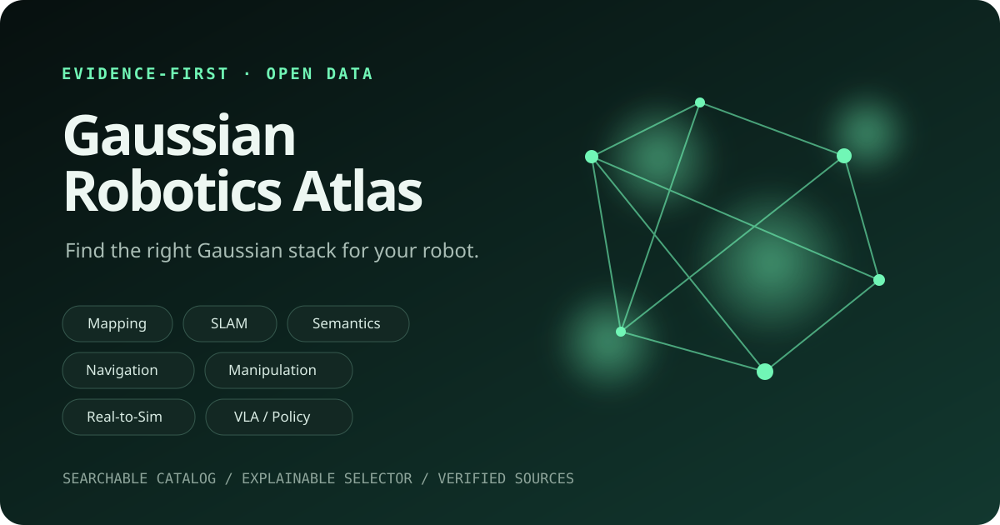

# Gaussian Robotics Atlas

**A decision-ready map of Gaussian Splatting for robots.**

[](CATALOG.md)
[](pyproject.toml)
[](LICENSE)
[](LICENSE-CODE)

<p align="center">
  
</p>

A paper title rarely tells you whether a method needs known poses, accepts depth,
ships usable code, or fits a navigation stack. Gaussian Robotics Atlas records those
details in a reviewed, machine-readable catalog. It helps roboticists build a shortlist
without turning another long paper list into a weekend of tab hunting.

The atlas covers Gaussian Splatting work with a direct robotics use: mapping and SLAM,
semantic perception, navigation, manipulation, robot learning, simulation, dynamic
scenes, and deployment tooling. It is a discovery aid, not a leaderboard.

## Pick a direction in 30 seconds

| You need to... | Start with | Check before committing |
|---|---|---|
| Track a camera and maintain a dense scene | `slam-localization` | Pose assumptions, online operation, RGB-D support |
| Build an editable map from a recorded run | `mapping-reconstruction` | Offline training cost, input poses, export format |
| Query a scene with language or semantic labels | `semantic-perception` | Open-vocabulary support, feature storage, query interface |
| Plan motion or reason about free space | `navigation-planning` | Geometry used for collision checks, update rate, dynamic obstacles |
| Grasp, place, or interact with objects | `manipulation-interaction` | Robot setup, object assumptions, grasp or affordance output |
| Train policies or create robot data | `robot-learning-vla` and `simulation-digital-twins` | Action interface, embodiment transfer, simulator integration |
| Work around people or moving objects | `dynamic-scenes` | Motion model, temporal input, online update support |
| Fit a system on limited hardware | `deployment-tooling` | Memory, platform support, license, measured hardware details |

Then narrow the results by sensor, framework, and code status:

```bash
python -m pip install -e .
gr-atlas recommend navigation --sensor rgb-d
gr-atlas search --category slam-localization --code-status released
```

Recommendations use visible metadata matches. They do not predict accuracy or rank
research quality.

## Use the atlas your way

- [Open the searchable static site](https://laityperfect7.github.io/awesome-gaussian-robotics/)
  for quick filtering. It runs in the browser without an account or analytics.
- [Browse the generated catalog](CATALOG.md) when you want a readable index.
- Use [JSON](docs/catalog.json) or [CSV](docs/catalog.csv) in your own tooling.
- Inspect the source records in [`catalog/`](catalog/) to see every stored field and
  supporting link.
- Read [Choose a Stack](guides/choose-a-stack.md) before mixing components, then use the
  [ROS2](guides/ros2-integration.md), [real-to-sim](guides/real2sim-for-vla.md), and
  [benchmarking](guides/benchmarking.md) guides at integration time.
- Start from the documented [architecture recipes](starter-stacks/README.md), or publish
  a commit-pinned result with the [reproducibility profile](profiles/README.md).

The Python package has no runtime dependencies and works locally:

```bash
python -m pip install -e .
gr-atlas validate
gr-atlas search "open vocabulary" --input monocular-rgb
gr-atlas recommend manipulation --framework pytorch --limit 5
gr-atlas stats
```

Maintainers can reproduce every generated artifact:

```bash
gr-atlas build
gr-atlas build --check
```

Run `gr-atlas --help` for all filters and output options.

## What a record tells you

Each entry answers practical questions that ordinary paper lists leave open:

| Field group | Examples |
|---|---|
| Task fit | category, capabilities, tags |
| Inputs | RGB, RGB-D, depth, LiDAR, events, language |
| Integration | pose requirement, frameworks, project and code URLs |
| Availability | released, partial, archived, paper-only, unavailable |
| Provenance | DOI or arXiv ID, source links, last verified date |

`unknown` is an honest value. We do not fill gaps by guessing from a screenshot, a
repository topic, or a method with a similar name.

## Evidence rules

The atlas uses three evidence tiers during review:

1. **Tier A, implementation evidence:** an official publication or project page and a
   public code repository support the record. Code status and license are reported as
   found; an unknown license stays unknown.
2. **Tier B, inspectable research:** official sources establish the method and its robot
   use, while code is partial or archived. The record says so plainly.
3. **Tier C, research lead:** an official paper or project source verifies the work, but
   no usable public implementation was found. Tier C entries are never presented as
   deployment-ready.

The canonical fields are the source URLs, `code_status`, `license`, and
`verified_date`. The tiers are a reading guide, not a hidden score.

We do not invent benchmark numbers, claim that a repository reproduces a paper, or
infer hardware compatibility without source evidence. Different papers report on
different datasets and machines, so the atlas does not turn those results into a
cross-paper ranking.

## What belongs here

A resource should make Gaussian representations useful in a robotics workflow or study
with a direct use in robotics. Rendering-only work belongs when it supplies a concrete robot
capability, such as localization, collision checking, manipulation, policy learning, or
simulation. General 3DGS papers without that connection are better served by the broader
community lists.

We favor primary sources, stable links, explicit limitations, and maintained code. A
small project with clear evidence is more useful here than a famous project described
with guesses.

## Contribute a resource or correction

The easiest contribution is an issue:

- [Suggest a resource](https://github.com/Laityperfect7/awesome-gaussian-robotics/issues/new?template=add-resource.yml)
- [Correct a record](https://github.com/Laityperfect7/awesome-gaussian-robotics/issues/new?template=correction.yml)
- [Report a broken link](https://github.com/Laityperfect7/awesome-gaussian-robotics/issues/new?template=broken-link.yml)

Pull requests are welcome too. Read [CONTRIBUTING.md](CONTRIBUTING.md) before editing the
catalog, and run `gr-atlas validate` plus `gr-atlas build --check` before opening the PR.
Maintainers ask for primary-source evidence because corrections should remain auditable
months later.

## Project policy

- The catalog and generated catalog artifacts are dedicated to the public domain under
  [CC0 1.0](LICENSE).
- The validator, CLI, and site generator use the [MIT License](LICENSE-CODE).
- See [LICENSES.md](LICENSES.md) for the exact data, software, documentation, and
  third-party scope.
- Linked papers, code, names, and logos keep their original owners and licenses.
- Security reports belong in [GitHub's private advisory form](SECURITY.md), not a public
  issue.

See the [roadmap](ROADMAP.md) for planned coverage and tooling. If this atlas saves you a
literature pass, a star helps other robotics teams find it. A sourced correction helps
even more.
