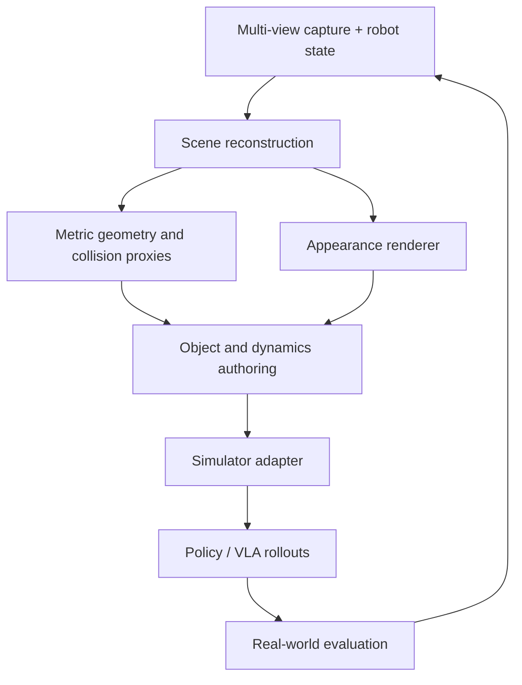

# Real-to-Sim for VLA and Robot Learning

Gaussian Splatting can reduce the visual gap between a captured workspace and a simulator, but a
scene model is not a complete training environment. A useful pipeline keeps appearance, geometry,
objects, contacts, robot state, and language annotations separable.

## What to verify

- **Capture:** Does the method assume static objects, external camera poses, or masked robot arms?
- **Geometry:** Can it produce collision geometry, or do you need depth fusion/meshing alongside
  the Gaussians?
- **Objects:** Are instances editable and persistent across views, or are semantics attached only
  to pixels/features?
- **Dynamics:** Which parameters come from system identification rather than visual reconstruction?
- **Rendering:** Are robot-mounted, moving cameras supported at policy-loop latency?
- **Labels:** Can language, action, and success annotations remain aligned after scene edits?
- **Transfer:** What real-world task metric decides whether the synthetic data helped?

## A conservative starter loop

1. Capture one bounded task cell with calibrated multi-view RGB-D and robot joint states.
2. Build the Gaussian appearance model and an independent metric collision proxy.
3. Segment only the task-relevant movable objects; keep a traceable source for each mask.
4. Import geometry and dynamics into the simulator, then connect the Gaussian renderer through a
   narrow camera interface.
5. Randomize lighting, appearance, object pose, and sensor noise without changing the evaluation
   distribution invisibly.
6. Train or fine-tune the policy; retain a non-Gaussian simulator baseline.
7. Evaluate real-world success, interventions, and failure modes—not render quality alone.

Use the atlas `simulation-digital-twins` and `robot-learning-vla` categories as discovery paths,
then check each project's actual export and runtime interfaces.
