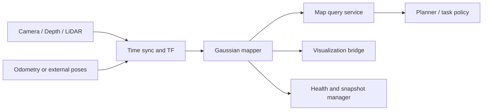

# ROS 2 Integration Blueprint

There is no universal ROS 2 message for a live Gaussian map. Treat the mapper as a bounded service
with explicit pose, image, snapshot, and query contracts. This keeps the robot stack useful even
when the underlying renderer or optimizer changes.

## Recommended boundaries

- **Sensor adapter:** validates timestamps, calibration, frame IDs, depth units, and dropped data.
- **Pose adapter:** makes the `map → odom → base_link → sensor` convention explicit. Never hide
  whether the method estimates poses or consumes them.
- **Mapper worker:** owns GPU state and accepts bounded queues. Back-pressure is preferable to
  silently reordering frames.
- **Query service:** exposes task outputs such as render, semantic lookup, occupancy/free-space
  samples, or object hypotheses. Do not expose raw optimizer internals as the stable API.
- **Snapshot manager:** writes versioned maps outside the control loop and records the code commit,
  calibration, and scene frame.
- **Health channel:** reports tracking state, last processed timestamp, queue depth, map size,
  memory pressure, and degraded modes.

## Integration checklist

1. Confirm the catalog's pose requirement and runtime inputs against the paper and repository.
2. Pin the implementation commit and container/toolchain before writing a bridge.
3. Define timestamp policy and `tf2` frame semantics in the package README.
4. Put GPU inference and map optimization outside executor callbacks.
5. Test reset, tracking loss, stale transforms, sensor dropout, and out-of-memory behavior.
6. Keep navigation safety on an independently validated geometric representation until Gaussian
   free-space and collision queries meet your system's assurance target.

The last point matters: a photorealistic Gaussian render is not automatically a safe occupancy
map.
